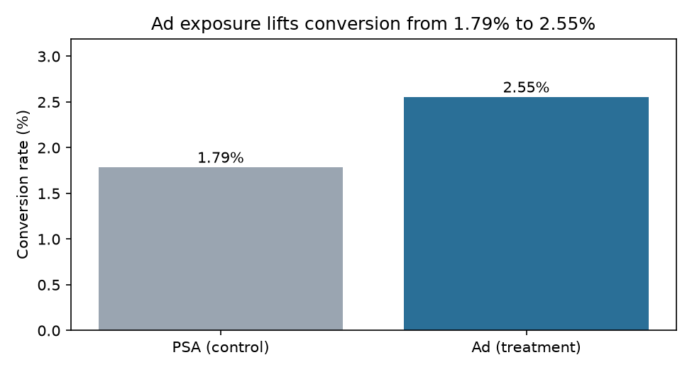

# Ad vs. PSA A/B Test: Conversion Readout

**Author:** Aadit Vora

**Role focus:** Product Analytics · **Tools:** SQL (DuckDB), Python (statistics from first principles), pytest

> **Business question:** Did showing an ad lift conversion compared with the control message (a public service announcement, PSA)? By how much, how sure are we, and can we trust the split?

## Headline results

Source: public marketing A/B dataset (ad vs. PSA exposure, 588,101 users, one row per user). Derived from the Kaggle "marketing A/B testing" data.

| Metric | Ad (treatment) | PSA (control) |
|---|---:|---:|
| Users | 564,577 | 23,524 |
| Conversions | 14,423 | 420 |
| Conversion rate | **2.55%** | 1.79% |

- **Absolute lift: +0.77 pp**, 95% CI **[+0.60, +0.94] pp**
- **Relative lift: +43%**, z = 7.37, p < 0.0001
- **About 4,300 incremental conversions** in the ad group (lift × ad users)
- Power: detecting a 0.5 pp lift at this baseline needs about **12,500 users per arm**; detecting 0.25 pp needs about **47,000 per arm**



## Data-quality flag: the split is not 50/50

**96% of users are in the ad group and 4% in control.** A 1:1 design was not used, or the assignment was not what the dataset suggests. A chi-square test against 50/50 gives χ² ≈ 497,800, far past any threshold.

What this means:

- The lift estimate assumes assignment was **random within the data**. Unbalanced allocation can also indicate a logging or assignment bug. That has to be checked against the experiment config before a ship decision.
- The control group is small (23.5K users), so the control rate has a wider interval than the treatment rate.
- Before running this kind of test in production, check the sample ratio first.

## Recommendation

**Conditional go.** The conversion lift is large and statistically clear in this data. Before shipping:

1. Confirm the allocation and the assignment logic. A 96/4 split is not a standard design.
2. Add a revenue or cost metric. Conversions do not show profit, and the cost per incremental conversion is not in the data.
3. Re-run the test with a balanced design for the decision. The current result is a readout of observational exposure data, not a clean experiment.

## Method

- `sql/01_staging.sql`: one row per user, with normalized variant labels.
- `sql/02_marts.sql`: per-variant conversion summary.
- `src/analysis.py`: two-proportion z-test, unpooled confidence interval, sample-ratio chi-square, and sample-size calculation.
- `tests/test_pipeline.py`: counts, rate reconciliation, a hand-checked z-statistic, and the sample-ratio flag.

## Limitations

- No revenue, cost, or guardrail metrics (for example, unsubscribes or complaints) are in the source.
- Exposure intensity (`total_ads`) is measured after assignment, so it is not randomized. It is not used for causal claims here.
- The dataset is a public sample. Confirm its origin and license before using it commercially.

## Reproduce

```bash
python -m pip install -r requirements.txt
python src/download.py      # downloads and verifies the file by SHA-256
python src/analysis.py      # writes outputs/metrics.json and figures/
python -m pytest -q         # 7 tests
```
